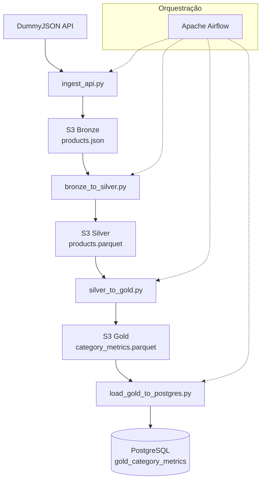

# Marketplace Data Engineering Pipeline

Projeto de Engenharia de Dados que constrói um pipeline completo de ingestão, transformação e carga de dados de produtos de um marketplace.

Os dados são extraídos de uma API pública, processados em camadas Bronze, Silver e Gold no Amazon S3 e as métricas finais são carregadas no PostgreSQL. A orquestração é feita com Apache Airflow em ambiente local via Docker.

## Arquitetura



## Tecnologias

- Python 3.12
- Apache Airflow 2.9.1
- PySpark
- Amazon S3
- PostgreSQL 13
- Docker e Docker Compose
- Terraform
- Apache Parquet

## Camadas de Dados

| Camada | Formato  | Descrição                        | Caminho no S3                       |
|--------|----------|----------------------------------|-------------------------------------|
| Bronze | JSON     | Dados brutos da API              | `bronze/products.json`              |
| Silver | Parquet  | Dados limpos e selecionados      | `silver/products.parquet/`          |
| Gold   | Parquet  | Métricas agregadas por categoria | `gold/category_metrics.parquet/`    |

## Qualidade de Dados

O pipeline possui validações em cada etapa:

- Presença de campos obrigatórios
- IDs únicos
- Preços maiores que zero
- Ausência de valores nulos em colunas críticas
- Verificação de volume mínimo de registros

Os scripts também limpam as pastas locais e os prefixos correspondentes no S3 antes de gravar novas versões, evitando acúmulo de arquivos e garantindo idempotência.

## Como Executar

1. Clone o repositório e acesse a pasta do projeto.
2. Crie um arquivo `.env` a partir do `.env.example` e configure as credenciais da AWS e do banco.
3. Suba os containers:
   ```bash
   docker compose up -d
   ```
4. Acesse a interface do Airflow em `http://localhost:8080`.
5. Localize e execute a DAG `marketplace_data_pipeline`.

## Estrutura do Projeto

```text
airflow-docker/
├── dags/
│   └── marketplace_pipeline.py
├── data/
│   ├── ingestion/
│   │   └── ingest_api.py
│   ├── spark_jobs/
│   │   ├── bronze_to_silver.py
│   │   └── silver_to_gold.py
│   └── database/
│       └── load_gold_to_postgres.py
├── terraform/
├── docker-compose.yaml
├── .env.example
└── README.md
```

## Resultado Validado

- 194 produtos ingeridos da API
- 194 registros processados na camada Silver
- 24 categorias geradas na camada Gold
- 24 linhas carregadas na tabela `gold_category_metrics`
- DAG executada com sucesso no Airflow

## Próximos Passos

- Implementar CI básico com GitHub Actions
- Adicionar alertas em caso de falha da DAG
- Evoluir o projeto com RAG e experimentos de fine-tuning (LoRA/QLoRA)

## Autor

Projeto desenvolvido como parte dos estudos e construção de portfólio em Engenharia de Dados.
