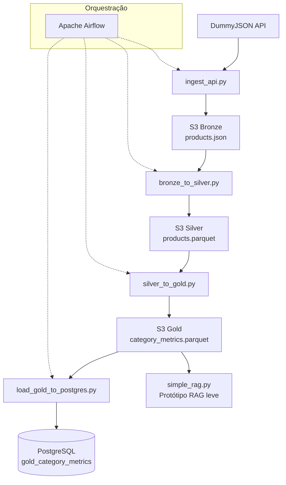

# Marketplace Data Engineering Pipeline

Pipeline de engenharia de dados que extrai produtos da DummyJSON API, processa em camadas Bronze → Silver → Gold no Amazon S3 e carrega métricas agregadas no PostgreSQL. Orquestrado com Apache Airflow em ambiente local (Docker).

O projeto foi evoluído com foco em práticas próximas de um ambiente de produção, mantendo custo baixo.

## Arquitetura



## Tecnologias

- Python 3.12
- Apache Airflow 2.9.1
- PySpark
- Amazon S3
- PostgreSQL 13
- Docker e Docker Compose
- Terraform
- Apache Parquet
- scikit-learn (protótipo RAG)

## Camadas de Dados

| Camada | Formato  | Descrição                        | Caminho no S3                       |
|--------|----------|----------------------------------|-------------------------------------|
| Bronze | JSON     | Dados brutos da API              | `bronze/products.json`              |
| Silver | Parquet  | Dados limpos e selecionados      | `silver/products.parquet/`          |
| Gold   | Parquet  | Métricas agregadas por categoria | `gold/category_metrics.parquet/`    |

## Práticas Aplicadas

- Usuário IAM de menor privilégio dedicado ao pipeline
- Qualidade de dados em todas as camadas (falha cedo)
- Idempotência via limpeza de pastas locais e prefixos no S3
- Alertas de falha por e-mail
- CI com validação de Terraform, lint (Ruff) e testes unitários
- Protótipo de RAG leve sobre a camada Gold

## Protótipo RAG Leve

Arquivo: `data/rag/simple_rag.py`

Utiliza TF-IDF e similaridade de cosseno para responder perguntas simples sobre as categorias da camada Gold.

**Limitações:**
- Melhor desempenho com palavras-chave diretas
- Similaridade tende a ser baixa em textos curtos
- Não substitui um sistema de RAG com embeddings densos
- Serve como prova de conceito educacional

**Exemplo de uso:**
```bash
docker compose exec airflow-worker python /opt/airflow/data/rag/simple_rag.py produtos baratos
```

## Como Executar

1. Clone o repositório e acesse a pasta do projeto.
2. Crie um arquivo `.env` baseado no `.env.example`.
3. Suba os serviços:
   ```bash
   docker compose up -d
   ```
4. Acesse o Airflow em `http://localhost:8080`.
5. Execute a DAG `marketplace_data_pipeline`.

## Estrutura do Projeto

```text
airflow-docker/
├── dags/marketplace_pipeline.py
├── data/
│   ├── ingestion/ingest_api.py
│   ├── spark_jobs/
│   │   ├── bronze_to_silver.py
│   │   └── silver_to_gold.py
│   ├── database/load_gold_to_postgres.py
│   └── rag/simple_rag.py
├── tests/test_quality.py
├── terraform/
├── .github/workflows/ci.yml
├── docker-compose.yaml
└── README.md
```

## Resultados Validados

- 194 produtos ingeridos da API
- 194 registros processados na camada Silver
- 24 categorias geradas na camada Gold
- 24 linhas carregadas no PostgreSQL
- DAG executada com sucesso
- CI passando

## Próximos Passos

- Melhorias de observabilidade
- Rotação de credenciais
- Evolução opcional do RAG ou experimentos de fine-tuning

## Autor

Projeto desenvolvido como estudo e portfólio em Engenharia de Dados, com ênfase em práticas próximas de produção e baixo custo.
